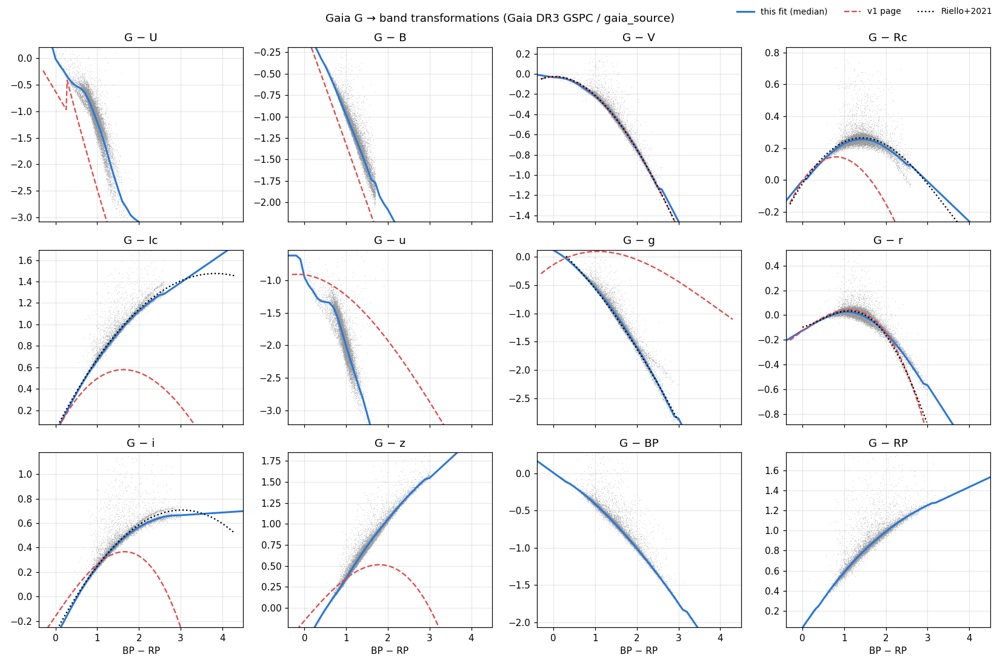

# Guide Camera Star Count Calculator

Static web calculator for guide-star availability on large-telescope guide cameras.
For any sensor format, pixel size and plate scale it predicts how many guide stars each
sensor sees anywhere on the sky — from **all-sky Gaia DR3 star counts**, not an analytic
Galaxy model — and fetches the real Gaia star fields of a sensor layout on demand.

**Open:** [`index.html`](index.html) — no build step; works from `file://` and from GitHub Pages
(<https://exoplanet5.github.io/starcounts/>).

Part of the MUST 6.5 m focal-plane GFA (guide, focus & alignment) design study.
v1 (April 2026) is in the git history of this folder; this README documents v2.

---

## What changed in v2

| | v1 | v2 |
|---|---|---|
| Star-count engine | analytic disk + spheroid, one r′ pole table × csc\|b\| | Gaia DR3: 1.8 billion sources binned in HEALPix-32 × G (0.5 mag) × BP−RP |
| Sky position | \|b\| only; prediction always at l = 180° | any (l, b) or (RA, Dec), or click the all-sky map |
| Band conversion | one fixed colour offset per band; several relations wrong (see audit) | per-star colour relations fitted to Gaia XP standardised photometry |
| Statistics | P(≥1), P(≥3) for one sensor | P(≥k) per sensor, P(≥M of n sensors with ≥k), P(total ≥ K), footprint coverage |
| Presets | none | 7 telescope plate scales, 24 guide-sensor formats |
| Catalogue check | ESA TAP (blocked by CORS) → VizieR → uniform simulation | CORS-enabled GAVO TAP polygon queries; simulation from the local Gaia tables |
| Response to an input change | chart only | full-sky map, two charts, coverage statistics in ~40–65 ms |

---

## Inputs

### Telescope (plate-scale presets)

The plate scale is the value **at the guide sensors** where known; fast wide-field correctors
change it by several per cent across the field.

| Preset | Plate scale (µm/″) | ″/mm | Basis | Site lat. | Guide cameras | Native guider preset |
|---|---|---|---|---|---|---|
| Rubin · LSSTCam | 50.0 | 20.0 | 8.4 m, EFL 10.31 m (f/1.23): 0.20″ per 10 µm pixel | −30.24° | 8 (4 corner rafts) | ITL STA3800C 4072×4000, 10 µm |
| DECam · Blanco 4 m | 57.0 | 17.5 | 0.263″ per 15 µm pixel at field centre | −30.17° | 4 guide + 8 focus | LBNL 2k×2k, 15 µm |
| DESI · Mayall 4 m | 73.2 | 13.7 | 0.205″ per 15 µm pixel at the GFAs (field edge); 67.5 µm/″ on axis | +31.96° | 6 guide + 4 WFS | e2v CCD230-42 frame transfer 2048×1032, 15 µm |
| 4MOST · VISTA 4.1 m | 59.4 | 16.8 | wide-field corrector plate scale (4MOST consortium) | −24.62° | 2 A&G (1 active) | not public (WFS: 2k×2k, 13.5 µm) |
| LAMOST · 4 m Schmidt | 96.96 | 10.3 | focal length 20 m | +40.40° | 4 | not public |
| WFST · 2.5 m | 30.06 | 33.3 | prime focus f/2.48, EFL 6.2 m: 0.333″ per 10 µm pixel | +38.61° | 4 | not public |
| MUST · 6.5 m | 116.87 | 8.56 | f = 24.105 m, F/3.70 (RD-008 quotes 118) | +38.61° | 6 (hexagonal ring) | — (detector under trade study) |
| Custom | — | | any value | | | |

"Use native guider" loads the sensor preset and camera count where the guider detector is public. Site latitude sets the
observable declination band for the footprint statistics.

### Guide sensor (chip X, Y, pixel presets)

| Group | Sensor | X × Y (px) | Pixel (µm) |
|---|---|---|---|
| Guide-camera CCDs | e2v CCD230-42 frame transfer (DESI GFA) | 2048 × 1032 | 15 |
| | e2v CCD230-42 full frame | 2048 × 2064 | 15 |
| | e2v CCD42-40 (VISTA AG) | 2048 × 2048 | 13.5 |
| | e2v CCD44-82 (VST AG) | 2048 × 4096 | 15 |
| | e2v CCD47-20 frame transfer (Magellan, PFS AGC) | 1024 × 1024 | 13 |
| | LBNL 2k×2k (DECam guide/focus) | 2048 × 2048 | 15 |
| | Hamamatsu S10892 (HSC AG) | 2048 × 4096 | 15 |
| Large-format survey CCDs | ITL STA3800C (Rubin guider) | 4072 × 4000 | 10 |
| | e2v CCD250 (LSSTCam) | 4096 × 4004 | 10 |
| | e2v CCD290-99 (WFST science) | 9216 × 9232 | 10 |
| Scientific CMOS | Gpixel GSENSE400BSI | 2048 × 2048 | 11 |
| | Gpixel GSENSE2020BSI | 2048 × 2048 | 6.5 |
| | Gpixel GSENSE4040BSI | 4096 × 4096 | 9 |
| | Gpixel GSENSE6060BSI | 6144 × 6144 | 10 |
| | Gpixel GSENSE9016BSI | 4096 × 4096 | 9 |
| | Gpixel GSENSE1517BSI | 4096 × 4096 | 15 |
| | Gpixel GSENSE64105BSI | 10240 × 10240 | 6.4 |
| | Gpixel GSENSE1081BSI | 8900 × 9120 | 10 |
| | Hamamatsu ORCA-Quest qCMOS | 4096 × 2304 | 4.6 |
| Consumer CMOS | Sony IMX455 (QHY600, ASI6200) | 9576 × 6388 | 3.76 |
| | Sony IMX411 (QHY411) | 14208 × 10656 | 3.76 |
| | Sony IMX571 (QHY268, ASI2600) | 6248 × 4176 | 3.76 |
| | Sony IMX432 (ASI432MM) | 1608 × 1104 | 9 |
| | Sony IMX174 (ASI174MM) | 1936 × 1216 | 5.86 |

GSENSE9016BSI and GSENSE64105BSI from the Gpixel datasheets (V0.1.1, V0.2.1); GSENSE1517BSI (effective 4096 × 4096,
4116 × 4100 readable) and GSENSE1081BSI from Gpixel's April 2026 astronomy-sensor presentation.

Derived: pixel scale = pixel / plate scale (″/px); FOV = chip × pixel scale; area = FOV_x × FOV_y.
For vignetting, edge margins or a frame-transfer store, enter the effective chip size.

### Band, window, pointing, requirement, footprint

- **Band:** SDSS u g r i z (AB), Johnson–Cousins U B V R<sub>C</sub> I<sub>C</sub> (Vega), Gaia G, G<sub>BP</sub>, G<sub>RP</sub>.
  Gaia G is also a fair proxy for an unfiltered back-illuminated silicon sensor.
- **Magnitude window:** bright (saturation) and faint (detection) limits.
- **Pointing:** Galactic or equatorial coordinates, a named field, or a click on the map.
- **Requirement:** k stars per sensor, M of n sensors meeting k, K stars in total, success level (default 95%).
- **Footprint:** |b| ≥ b<sub>min</sub> and declinations reachable within a zenith distance of the site.

All settings are kept in the URL hash (**Copy link** shares a configuration).

## Outputs

1. **At the pointing** — expected stars per sensor λ (and density), P(≥1), P(≥k) per sensor and for all n,
   P(≥M of n sensors with ≥k), expected total and P(total ≥ K); each probability with a
   meets / marginal / short status. Gaia completeness at the pointing and the v1 prediction are shown for reference.
2. **All-sky map** (equatorial Mollweide by default, or Galactic) of λ or any of the probabilities, with the
   success-level contour, the footprint (outside dimmed) and Gaia-incomplete pixels hatched. Hover for values,
   click to move the pointing. Below it: footprint area, λ percentiles and the fraction of the footprint that meets each requirement.
3. **Charts** — cumulative stars per sensor vs limiting magnitude (pointing and |b| = 90°, 60°, 30°, 20°, 10° medians),
   and λ vs |b| (median and 10–90% range over longitude, the λ needed for P(≥k) at the success level, and the v1 curve).
   Both have hover read-outs and a table view.
4. **Real-sky check** — n sensor footprints, placed on a ring around the pointing (tangentially oriented, radius from the
   telescope preset) or at random longitudes at the same b, are queried from Gaia DR3; observed counts are compared with λ.

---

## Method

### Gaia DR3 count tables (`data/gaia_dr3_counts.js`)

Built from `gaiadr3.gaia_source` with server-side aggregation on the ESA Gaia archive
(`tools/fetch_gaia.py`; ~200 queries, each restricted to one HEALPix pixel via the source_id range):

| Table | Grid | Encoding |
|---|---|---|
| counts | HEALPix nside 32 (3.36 deg², NESTED, ICRS) × 31 G bins, G 6.0–21.5 by 0.5 | uint16, log₂ code (0.27% steps) |
| colour mix | nside 8 × G bin × 12 BP−RP classes (edges 0.2 0.4 0.6 0.8 1.0 1.2 1.4 1.6 2.0 2.4 3.0) | uint8 fractions summing to 255 |
| class mean colour | G bin × class (all-sky) | float |
| colour offset | nside 32: mean BP−RP of the pixel minus that of its nside-8 parent (reddening) | int8 × 0.02 mag |
| completeness | nside 32: G where dN/dG turns over | uint8 × 0.1 mag |

Sources without BP−RP (faint or crowded) are distributed like those with colours in the same cell.

For band X and magnitude m, the cumulative count in a pixel is
`N(<m) = Σ_g Σ_c n(p, g) · f(P, g, c) · F(m + f_X(c̄ + Δc_p) − G_g)`,
where `F` is the fraction of the 0.5-mag bin below the threshold (uniform within the bin).
λ = [N(<m_faint) − N(<m_bright)] / Ω_pix × A_sensor. The pointing value is a tent-weighted mean over the
containing and neighbouring pixels, so it varies smoothly across pixel borders.

### Band relations (`tools/fit_bands.py`)

`G − X = f_X(BP−RP)` is the running median (0.05-mag colour bins, local-quadratic smoothing, tabulated every 0.1 mag
for BP−RP −0.4…4.5) of 353 000 Gaia DR3 stars with XP standardised synthetic photometry (GSPC, flag = 1) from 120
random HEALPix-5 pixels; G<sub>BP</sub>, G<sub>RP</sub> from 59 000 gaia_source stars. GSPC gives U and B only in the
colour range where the XP standardisation is valid (U: BP−RP 0.2–1.6, B: 0.6–1.7); outside it they follow the Mamajek
dwarf colour sequence, continuous at the edge, and u follows U. Agreement with Riello et al. (2021) is ≲ 0.05 mag for
V, R<sub>C</sub>, I<sub>C</sub>, g, i over BP−RP 0.3–3.



### Probabilities

Stars on a sensor are Poisson(λ). Sensors are treated as independent fields at the local density (clustering on
scales larger than a sensor is in the map). P(≥M of n sensors with ≥k) is binomial in P(≥k); the total is Poisson(nλ).

### Live star fields

Each sensor footprint is a 4-vertex `POLYGON` query to the GAVO Data Center TAP mirror of Gaia DR3
(`gaia.dr3lite`, CORS-enabled, ~2 s per sensor at high latitude), three at a time with a 30 s timeout. The G range is the
exact span `[m_bright + min f_X, m_faint + max f_X]`, and each star is converted with the same `f_X` as the model. If the
service is unreachable, fields are drawn from the local tables (Poisson counts, magnitudes from the pixel's own luminosity
function) and labelled "simulated".

---

## Accuracy

### Validation

**Table model vs exact Gaia counts per sky pixel** (`tests/test_model.mjs`; 400 random pixels; exact = each
0.2-mag BP−RP class of the full-resolution histogram converted separately; ratio model/exact):

| Band, window | median | 5–95% | | Band, window | median | 5–95% |
|---|---|---|---|---|---|---|
| G 15–19 | 1.000 | 0.999–1.001 | | z 15–19 | 1.001 | 0.993–1.010 |
| r 15–19 | 1.000 | 0.994–1.006 | | R<sub>C</sub> 14–18.5 | 1.001 | 0.997–1.005 |
| r 17–19.5 | 1.000 | 0.993–1.010 | | g 15–19 | 0.999 | 0.990–1.019 |
| V 15–19 | 1.001 | 0.995–1.014 | | B 15–19 | 0.997 | 0.977–1.020 |
| i 16–20 | 1.001 | 0.997–1.006 | | U 14–18 | 1.000 | 0.968–1.053 |

The largest deviations are in the most reddened plane pixels (|b| < 5°: g/B ±10%, U ±20%).

**Table model vs star-by-star counts in cones** (`tests/validate_counts.mjs`; every Gaia star in the cone converted
individually). At the NGP, (180°, +60°), (180°, +30°) and (180°, −10°) all bands agree within 3% once the G-band
cone-vs-pixel area term is removed. Pixel-sized (1°) cones at |b| = 10–20° agree within 2% in G, r, V, i, R, within 5% in z, g, B
and within 14% in U. Small cones in dust lanes (0.12° at l = 30°, b = +5°) differ by up to a factor of 2–4 in blue
bands — sub-pixel extinction structure that a 1.8° table cannot resolve; use the real-sky check there.

Direct 1° cone counts at the NGP: G < 17 / 19 / 20 = 420 / 1020 / 1566 deg⁻² vs table 415 / 1008 / 1548.
Live check, MUST default (six 19.3 arcmin² sensors on a 1.3° ring at l = 180°, b = 80°, r 17–19): 17 stars observed vs 16.3 ± 4.0 predicted.

### v2 vs v1

Cumulative counts at the North Galactic Pole (deg⁻²):

| | r < 17 | r < 19 | r < 20 | G < 17 | G < 20 |
|---|---|---|---|---|---|
| Gaia DR3 (v2) | 404 | 951 | 1483 | 414 | 1556 |
| v1 analytic | 250 | 1200 | 2800 | 232 | 2572 |

Stars per MUST CCD230-42 full-frame sensor (19.3 arcmin²), r 17–19:

| Field | v2 | v1 | v1 / v2 |
|---|---|---|---|
| NGP | 2.94 | 5.10 | 1.73 |
| l 180°, b 60° | 2.98 | 5.79 | 1.94 |
| l 180°, b 30° | 7.64 | 9.53 | 1.25 |
| l 180°, b 20° | 16.3 | 13.6 | 0.83 |
| l 90°, b 20° | 24.6 | 13.6 | 0.55 |
| l 0°, b 20° | 42.4 | 15.6 | 0.37 |
| l 0°, b 10° | 275 | 58 | 0.21 |

v1 over-predicted the faint high-latitude counts that set guide-camera size by ×1.7–1.9, and under-predicted
the inner Galaxy by up to ×5 (no longitude dependence beyond a bulge term, and l fixed at 180°).

### Check of the MUST guider star-count requirement

RD-008 sizes the guider at 15.3 arcmin² assuming **0.20 stars/arcmin² at R ≤ 17 near the Galactic pole**; the
guider-sensor review, using the v1 model, put it at 0.069. Gaia DR3 gives **0.135 arcmin⁻²** (median over |b| > 80°;
0.47 at |b| = 30°, 0.85 at |b| = 20°). Recomputed (R<sub>C</sub>, cumulative, |b| > 80° median):

| Area (arcmin²) | R < | λ | P(≥1) | P(≥3) | P(all 6 ≥ 1) | P(≥3 of 6 with ≥ 1) |
|---|---|---|---|---|---|---|
| 15.3 | 17 | 2.06 | 87% | 34% | 44% | >99% |
| 25 | 17 | 3.36 | 97% | 65% | 81% | >99% |
| 15.3 | 18.5 | 3.89 | 98% | 75% | 88% | >99% |
| 19.4 (CCD230-42 full frame) | 18.5 | 4.93 | 99% | 87% | 96% | >99% |
| 25 | 18.5 | 6.36 | >99% | 95% | 99% | >99% |

The review's conclusion stands (≥ 25 arcmin² and R ≤ 18.5 for ≥ 3 stars per sensor at 95% at the pole), but a
15.3 arcmin² sensor at R ≤ 17 reaches P(≥3) ≈ 34%, not 9%.

---

## Audit of v1

Measured with the original `index.html` in headless Chrome and against the Gaia tables.

**Accuracy**
- *Galaxy model.* One r′ pole luminosity function scaled by csc|b|, with a cos l bulge term: no extinction, no disc
  longitude structure, no Magellanic Clouds. The prediction and the chart always used l = 180°. Errors ×0.2–1.9 (table above).
- *Band conversions.* The SDSS g′ relation had the signs of its constant and linear terms flipped (0.5 mag wrong at
  solar colour, 1.1 mag at BP−RP = 1.5); u′ was built on it; B−V from BP−RP was 0.28 mag too red for the Sun;
  at BP−RP = 2.5, U, B, R<sub>C</sub>, I<sub>C</sub>, i′ and z′ were 0.5–2.6 mag off (`figures/band_transforms.png`). Real-sky fields were filtered in the wrong window.
  Model counts in other bands used one fixed colour offset from r′.
- *Input bug.* `parseFloat(x) || default` turned b = 0 (and magnitude 0) into the defaults: b = 0 returned the b = 80° prediction.
- *Catalogue truncation.* `TOP 2000 … ORDER BY phot_g_mean_mag` silently dropped the faint end: at l = 0°, b = 10° a
  19 arcmin² sensor's padded cone holds ~2600 stars.
- *Simulation fallback.* Uniform magnitudes between the limits instead of the steep luminosity function.

**Efficiency**
- *Dead primary endpoint.* The ESA TAP service sends no CORS headers, so every browser query to it fails. In the test
  network the VizieR fallback was unreachable too; "Generate Star Fields" returned six *simulated* fields after **22.8 s**.
- *Over-fetching.* G range padded ±1.5 mag and a cone circumscribing the sensor (×1.9 area): 4.3× (pole) to 7.2× (inner Galaxy)
  more rows than needed for r 17–19. v2 queries the exact sensor polygon and the exact G span of the band window.
- *Unbounded concurrency.* Up to 20 simultaneous sync queries with no timeout or cancel; v2 runs 3 at a time with a 30 s abort.
- *Rendering.* Glow (`shadowBlur`) on every star and curve. v2 renders the whole sky (12 288 pixels × 12 colour classes × 31 G bins),
  two charts and coverage statistics in ~40–65 ms per input change, after a ~0.4 s first load (1.5 MB data, ~0.8 MB gzipped).

## Rebuilding the data

```bash
python tools/fetch_gaia.py hist    # all-sky (HEALPix-5, G, BP-RP) histograms -> tools/cache/hist (~45 min, 192+ queries)
python tools/fetch_gaia.py gspc    # GSPC sample (120 pixels)                 -> tools/cache/gspc
python tools/fetch_gaia.py bprp    # G/BP/RP sample from GAVO                 -> tools/cache/bprp
curl -o tools/cache/ext/mamajek_dwarfs.txt https://www.pas.rochester.edu/~emamajek/EEM_dwarf_UBVIJHK_colors_Teff.txt
python tools/fit_bands.py          # -> tools/cache/bands.json, figures/band_transforms.png
python tools/build_data.py         # -> data/gaia_dr3_counts.js
```

Anonymous ESA archive queries stop after 60 s; the fetcher splits any chunk that times out into its four HEALPix children.
Tests: `python tests/ref_geometry.py ref.json && node tests/test_core.js ref.json` (HEALPix, frames, projections and
statistics against healpy/astropy/scipy) and `node tests/validate_counts.mjs` (model vs star-by-star Gaia counts).

## Files

| Path | |
|---|---|
| `index.html` | page and styles |
| `js/core.js` | geometry, HEALPix, count model, statistics (also loads in Node) |
| `js/app.js` | inputs, presets, map, charts, live fields |
| `data/gaia_dr3_counts.js` | Gaia DR3 tables and band relations (generated) |
| `tools/` | data fetch, band fit and table build scripts |
| `tests/` | unit, validation and headless-browser smoke tests |
| `figures/band_transforms.png` | G − X relations, with Riello+2021 and v1 for comparison |

## Limitations

- Gaia DR3 is complete to G ≈ 20.7 at high latitude but only to G ≈ 18–19 in the most crowded bulge fields; such
  pixels are hatched and their counts are lower limits.
- Gaia includes some compact galaxies and spurious sources at G > 20 (a few per cent at guide-star magnitudes).
- Saturation, blending, cosmetics and vignetting are not modelled; enter the usable chip area.
- One plate scale per sensor (e.g. DESI changes from 67.5 to ~73 µm/″ across its field).
- Telescope sites and guide-ring radii are approximate and only affect the footprint statistics and the live-field layout.

## References

- Gaia Collaboration, Vallenari et al. 2023, A&A 674, A1 — Gaia DR3 summary
- Gaia Collaboration, Montegriffo et al. 2023, A&A 674, A33 — XP synthetic photometry (GSPC)
- Riello et al. 2021, A&A 649, A3 — Gaia EDR3 photometric relations
- Pecaut & Mamajek 2013, ApJS 208, 9; Mamajek, *A Modern Mean Dwarf Stellar Color and Effective Temperature Sequence* (online table)
- Górski et al. 2005, ApJ 622, 759 — HEALPix
- Bahcall & Soneira 1980, ApJS 44, 73 — basis of the v1 analytic model
- DESI Collaboration 2022, AJ 164, 207 — DESI instrument overview (GFA)
- 4MOST consortium, <https://www.4most.eu/cms/facility/subsystems/>
- ESA Gaia archive <https://gea.esac.esa.int/archive/>; GAVO Data Center TAP <https://dc.g-vo.org/tap>
